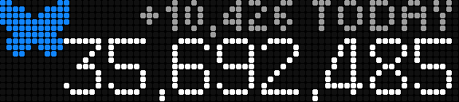
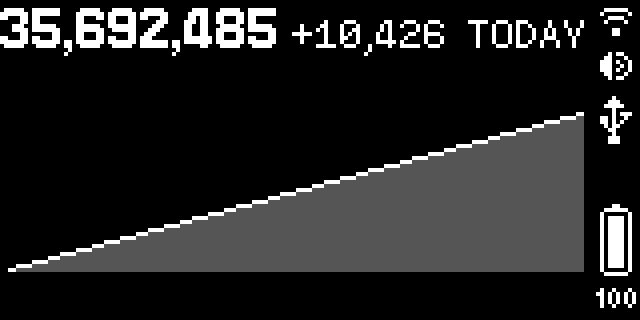
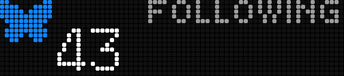
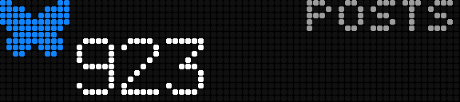
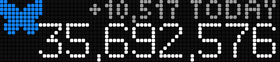
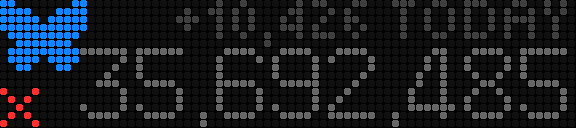
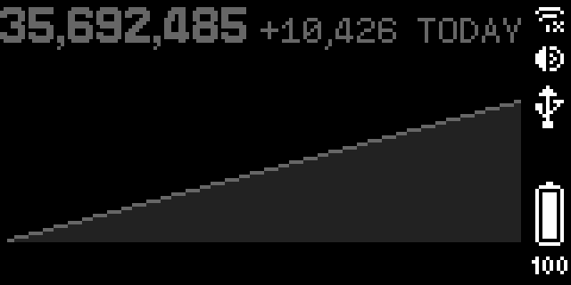
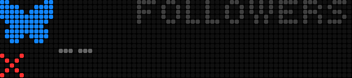
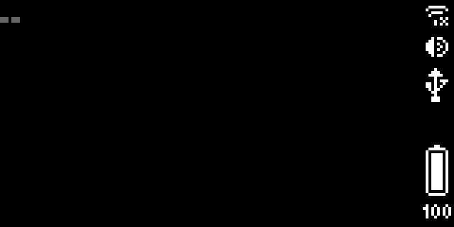
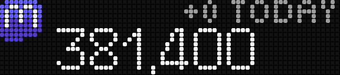

# Follower Counter

Your Bluesky or Mastodon follower count, live.



Put your Bluesky or Mastodon handle in the settings, and the bar shows how many followers you have and how many you gained today. Fireworks go off when the count passes a round number, and the back display draws your followers over the last 24 hours.

A JavaScript app for [BUSY Bar](https://busy.app).

## What the bar shows

The front display shows the network's logo, the Bluesky butterfly or the Mastodon "m", and the follower count in large digits. Top right are the followers gained since midnight, such as `+10,426 TODAY`; while no count since midnight is known, it says FOLLOWERS.

The back display shows the followers, the day's gain, and a graph of the last 24 hours, a column for every 10 minutes, the newest on the right. The graph is scaled from the day's lowest count to its highest; a column where the count is not known, because the app was closed or its polls failed, stays empty.



Turning the wheel switches the front display to the accounts you follow, then to your posts, then back to the followers.





When the followers pass a multiple of the fireworks step, 100 by default, fireworks go off across the front display, with a sound and a blink of the status light. Each multiple counts once, above the most followers seen since the app started; the first count after the start sets no fireworks off.



When a poll fails, the counts of the last good one stay, dimmed, with a red cross under the logo; the back display dims too.





With no good poll yet for this account, the front shows `--` with the red cross, and the back display `--`.





A Mastodon account shows the Mastodon logo. On the first day the app counts it, the gain starts from the first count, `+0 TODAY`.



## Buttons

| Button | What it does |
| --- | --- |
| Wheel | Switches between followers, following and posts. |
| Back | Quits the app. |

## Settings

| Setting | What it does |
| --- | --- |
| Network | Where the account is: Bluesky or Mastodon. Bluesky by default. |
| Handle | Bluesky: `name.bsky.social`. Mastodon: `user@instance`. `bsky.app` by default. |
| Fireworks every | Fireworks when the followers pass a multiple of this. 100 by default. |

The app reads its settings when it starts. A changed network or handle starts the history over.

## Data

The public Bluesky and Mastodon APIs, no keys needed: Bluesky's `app.bsky.actor.getProfile` on `public.api.bsky.app`, and for Mastodon `/api/v1/accounts/lookup` on the account's own instance. The app polls once when it starts and then every 10 minutes. It keeps the counts of the last good poll and the followers of the last day in its local storage on the BUSY Bar, so the gain and the graph survive a restart.

## Build

Node 24 and npm:

```sh
npm ci
npm run build         # dist/io.github.vvzvlad.followers.tgz
npm run app:install   # install it on a BUSY Bar connected over USB
npm run app:run       # start it
```

## License

[MIT](LICENSE)
